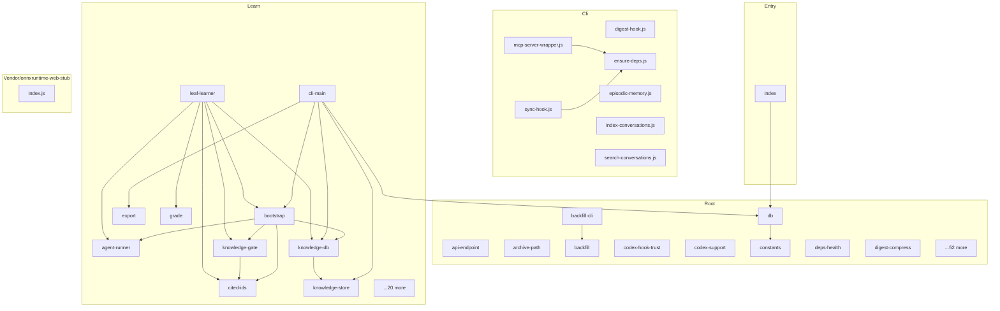

<!-- repo-map:no-verification -->
<!-- GENERATED FILE -- do not edit by hand.
     Regenerate with `repo-tools map`. -->

# episodic-memory - Dependency Graph

**Version**: 1.8.0

This document provides a comprehensive dependency graph of all files, components, imports, functions, and variables in the codebase.

---

## Table of Contents

1. [Overview](#overview)
2. [Package Dependencies](#package-dependencies)
3. [Cli Dependencies](#cli-dependencies)
4. [Root Dependencies](#root-dependencies)
5. [Entry Dependencies](#entry-dependencies)
6. [Learn Dependencies](#learn-dependencies)
7. [Vendor/onnxruntime web stub Dependencies](#vendor-onnxruntime-web-stub-dependencies)
8. [Dependency Matrix](#dependency-matrix)
9. [Circular Dependency Analysis](#circular-dependency-analysis)
10. [Visual Dependency Graph](#visual-dependency-graph)
11. [Summary Statistics](#summary-statistics)

---

<a id="overview"></a>
## Overview

The codebase is organized into the following modules:

- **cli**: 7 files
- **root**: 62 files
- **entry**: 1 file
- **learn**: 30 files
- **vendor/onnxruntime-web-stub**: 1 file

---

<a id="cli-dependencies"></a>

## Cli Dependencies

### `cli/digest-hook.js` - SessionStart hook: print the project digest and the learned block as additional context.

**Node.js Built-in Dependencies:**
| Module | Import |
|--------|--------|
| `fs` | `default` |
| `path` | `default` |

---

### `cli/ensure-deps.js` - Make node_modules usable before anything opens the database. Shared by the MCP wrapper and the

**Node.js Built-in Dependencies:**
| Module | Import |
|--------|--------|
| `child_process` | `spawnSync` |
| `path` | `join` |

**Exports:**
- Functions: `ensureDeps`
- Constants: `NPM_INSTALL_ARGS`

---

### `cli/episodic-memory.js` - `learn` opens the knowledge store on better-sqlite3 13, which requires Node >= 22; `engines` only warns.

**Node.js Built-in Dependencies:**
| Module | Import |
|--------|--------|
| `url` | `fileURLToPath` |
| `path` | `dirname, join` |
| `child_process` | `spawn` |
| `fs` | `realpathSync` |

---

### `cli/index-conversations.js` - index-conversations.js module

**Node.js Built-in Dependencies:**
| Module | Import |
|--------|--------|
| `url` | `fileURLToPath` |
| `path` | `dirname, join` |
| `child_process` | `spawn` |
| `fs` | `realpathSync` |
| `readline` | `createInterface` |

---

### `cli/mcp-server-wrapper.js` - Cross-platform wrapper script for MCP server that ensures dependencies are installed

**Node.js Built-in Dependencies:**
| Module | Import |
|--------|--------|
| `child_process` | `spawn` |
| `fs` | `existsSync` |
| `path` | `dirname, join` |
| `url` | `fileURLToPath` |

**Internal Dependencies:**
| File | Imports | Type |
|------|---------|------|
| `./ensure-deps.js` | `ensureDeps` | Import |

---

### `cli/search-conversations.js` - search-conversations.js module

**Node.js Built-in Dependencies:**
| Module | Import |
|--------|--------|
| `url` | `fileURLToPath` |
| `path` | `dirname, join` |
| `child_process` | `spawn` |
| `fs` | `realpathSync` |

---

### `cli/sync-hook.js` - SessionStart hook entry point. Runs sync --background and logs failures to

**Node.js Built-in Dependencies:**
| Module | Import |
|--------|--------|
| `child_process` | `spawn, execFileSync` |
| `fs` | `default` |
| `path` | `default` |
| `url` | `fileURLToPath, pathToFileURL` |

**Internal Dependencies:**
| File | Imports | Type |
|------|---------|------|
| `./ensure-deps.js` | `ensureDeps` | Import |

---

<a id="root-dependencies"></a>

## Root Dependencies

### `src/api-endpoint.ts` - Validate custom summarizer API base URLs.

**Exports:**
- Types: `ApiBaseUrlValidation`
- Functions: `validateApiBaseUrl`

---

### `src/archive-path.ts` - Archive path confinement for the MCP `read` tool.

**Node.js Built-in Dependencies:**
| Module | Import |
|--------|--------|
| `fs` | `default` |
| `path` | `default` |
| `readline` | `default` |

**Internal Dependencies:**
| File | Imports | Type |
|------|---------|------|
| `./paths.js` | `getArchiveDir` | Import |

**Exports:**
- Functions: `maxReadBytes`, `resolveArchiveJsonlPath`, `safeArchiveSummaryPath`, `readJsonlLines`
- Constants: `DEFAULT_MAX_READ_BYTES`

---

### `src/backfill-cli.ts` - Dependency-light imports first, as in sync-cli: the guard and help paths must exit fast.

**Internal Dependencies:**
| File | Imports | Type |
|------|---------|------|
| `./paths.js` | `getArchiveDir` | Import |
| `./logging.js` | `getSyncLockPath` | Import |
| `./reentrancy.js` | `shouldSkipReentrantSync` | Import |
| `./lockfile.js` | `acquireLock, releaseLock` | Import |
| `./backfill.js` | `*` | Import |

---

### `src/backfill.ts` - Archive backfill: summarize conversations that sync can never reach.

**Node.js Built-in Dependencies:**
| Module | Import |
|--------|--------|
| `fs` | `default` |
| `path` | `default` |

**Internal Dependencies:**
| File | Imports | Type |
|------|---------|------|
| `./paths.js` | `getExcludedProjects` | Import |
| `./gpu-reservation.js` | `gpuReservationBlock` | Import |
| `./ollama-backend.js` | `summarizerBackend` | Import |
| `./sync.js` | `extractSessionIdFromPath, isTerminalFailRecord, shouldSkipConversation, summarizeOneFile` | Import |
| `./summarizer.js` | `*` | Import |

**Exports:**
- Interfaces: `BackfillCandidate`, `BackfillOptions`, `BackfillResult`
- Functions: `selectBackfillCandidates`, `backfillArchive`, `batchVerdict`

---

### `src/codex-hook-trust.ts` - The trust state that Codex reports for the episodic-memory hooks.

**Node.js Built-in Dependencies:**
| Module | Import |
|--------|--------|
| `child_process` | `spawn` |
| `readline` | `default` |

**Exports:**
- Types: `CodexHookTrustState`
- Functions: `trustStateFromHooksList`, `detectCodexHookTrustState`

---

### `src/codex-support.ts` - The minimum Codex CLI version that summarization requires.

**Exports:**
- Functions: `parseCodexCliVersion`, `compareSemver`, `versionMeetsMinimum`, `codexVersionRequirementMessage`
- Constants: `MIN_CODEX_VERSION`

---

### `src/constants.ts` - Marker text that identifies summarizer agent conversations.

**Exports:**
- Functions: `truncationNoticeFor`, `truncateForIndex`, `topicsEnabled`, `envPositiveInt`
- Constants: `SUMMARIZER_CONTEXT_MARKER`, `MAX_INDEXED_MESSAGE_BYTES`, `OLLAMA_MAX_PROMPT_CHARS_DEFAULT`, `CLAUDE_MAX_PROMPT_CHARS`, `TOPIC_DEFAULTS`

---

### `src/db.ts` - The options for `openDatabase`.

**External Dependencies:**
| Package | Import |
|---------|--------|
| `better-sqlite3` | `default` |
| `sqlite-vec` | `*` |

**Node.js Built-in Dependencies:**
| Module | Import |
|--------|--------|
| `path` | `default` |
| `fs` | `default` |

**Internal Dependencies:**
| File | Imports | Type |
|------|---------|------|
| `./types.js` | `ConversationExchange` | Import |
| `./paths.js` | `getDbPath, tryChmod` | Import |
| `./embedding-migration.js` | `EMBEDDING_VERSION` | Import |
| `./constants.js` | `truncateForIndex` | Import |
| `./redact.js` | `maybeRedactSecrets` | Import |
| `./digest-db.js` | `ensureDigestSchema` | Import |

**Exports:**
- Interfaces: `OpenDatabaseOptions`
- Functions:

  ```text
  migrateSchema, migrateToolCallsCascade, ensureFts, upsertExchangeFts, deleteExchangeFts,
  openDatabase, openDatabaseReadonly, initDatabase, getSharedReaderDatabase,
  closeSharedReaderDatabase, insertExchange, getAllExchanges, getFileLastIndexed, getMaxIndexedLine,
  getFreelistInfo, vacuumDatabase, deleteExchange
  ```


---

### `src/deps-health.ts` - node_modules health check shared by the MCP wrapper, the SessionStart sync hook and `doctor`.

**Node.js Built-in Dependencies:**
| Module | Import |
|--------|--------|
| `fs` | `existsSync` |
| `path` | `join` |

**Exports:**
- Functions: `nativeAddonPresent`, `nodeModulesIsHealthy`, `repairPlan`
- Constants: `NATIVE_ADDON`, `JS_SENTINELS`, `DEP_SENTINELS`

---

### `src/digest-compress.ts` - Options for `compressDigest`. Each field is optional and replaces its default.

**External Dependencies:**
| Package | Import |
|---------|--------|
| `better-sqlite3` | `default` |

**Internal Dependencies:**
| File | Imports | Type |
|------|---------|------|
| `./summarizer.js` | `callDigestModel` | Import |
| `./ollama-backend.js` | `GpuReservedError` | Import |
| `./digest-prompts.js` | `buildCompressPrompt` | Import |
| `./digest-validate.js` | `parseCitedLines, redactEntryText` | Import |
| `./digest-db.js` | `insertDigestEntry, listActiveByTier, supersede, DigestEntry, DigestTier` | Import |

**Exports:**
- Interfaces: `CompressOptions`, `CompressResult`
- Functions: `compressDigest`

---

### `src/digest-db.ts` - One digest entry describes one project for one period.

**External Dependencies:**
| Package | Import |
|---------|--------|
| `better-sqlite3` | `default` |

**Internal Dependencies:**
| File | Imports | Type |
|------|---------|------|
| `./fts-query.js` | `toFtsQuery` | Import |

**Exports:**
- Interfaces: `DigestEntry`
- Types: `DigestTier`
- Functions: `ensureDigestSchema`, `insertDigestEntry`, `listActiveEntries`, `listActiveByTier`, `supersede`, `citedExchangeIds`, `hideCitedLines`, `searchDigest`

---

### `src/digest-inject.ts` - Returns the digest character limit from the `EPISODIC_MEMORY_DIGEST_MAX_CHARS` environment variable.

**External Dependencies:**
| Package | Import |
|---------|--------|
| `better-sqlite3` | `default` |

**Internal Dependencies:**
| File | Imports | Type |
|------|---------|------|
| `./digest-db.js` | `hideCitedLines, listActiveEntries, DigestEntry` | Import |

**Exports:**
- Functions: `projectKeyFromCwd`, `digestMaxChars`, `buildDigestText`
- Constants: `DEFAULT_DIGEST_MAX_CHARS`

---

### `src/digest-job.ts` - Return true when the digest feature is on.

**External Dependencies:**
| Package | Import |
|---------|--------|
| `better-sqlite3` | `default` |

**Internal Dependencies:**
| File | Imports | Type |
|------|---------|------|
| `./types.js` | `ConversationExchange` | Import (type-only) |
| `./reentrancy.js` | `shouldSkipReentrantSync` | Import |
| `./gpu-reservation.js` | `gpuReservationBlock` | Import |
| `./ollama-backend.js` | `GpuReservedError, summarizerBackend` | Import |
| `./summarizer.js` | `callDigestModel, promptBudgetChars` | Import |
| `./digest-prompts.js` | `buildSessionPrompt` | Import |
| `./digest-validate.js` | `parseCitedLines, redactEntryText` | Import |
| `./digest-db.js` | `insertDigestEntry` | Import |
| `./digest-compress.js` | `compressDigest` | Import |

**Exports:**
- Interfaces: `DigestOptions`, `DigestResult`, `ExchangeRow`
- Functions: `digestEnabled`, `toExchange`, `sessionExchanges`, `isTrivial`, `runDigest`
- Constants: `QUIET_MS`

---

### `src/digest-phase.ts` - The digest step of a sync run.

**External Dependencies:**
| Package | Import |
|---------|--------|
| `better-sqlite3` | `default` |

**Internal Dependencies:**
| File | Imports | Type |
|------|---------|------|
| `./digest-job.js` | `digestEnabled, runDigest, DigestOptions, DigestResult` | Import |
| `./db.js` | `initDatabase` | Import |

**Exports:**
- Functions: `runDigestPhase`

---

### `src/digest-prompts.ts` - A summarizer prompt, with the numbers that the prompt uses.

**Internal Dependencies:**
| File | Imports | Type |
|------|---------|------|
| `./constants.js` | `SUMMARIZER_CONTEXT_MARKER` | Import |
| `./types.js` | `ConversationExchange` | Import (type-only) |
| `./digest-db.js` | `DigestEntry` | Import (type-only) |
| `./digest-validate.js` | `redactEntryText` | Import |

**Exports:**
- Interfaces: `BuiltPrompt`
- Functions: `numberExchanges`, `buildSessionPrompt`, `buildCompressPrompt`

---

### `src/digest-tool.ts` - digest-tool module

**Internal Dependencies:**
| File | Imports | Type |
|------|---------|------|
| `./db.js` | `initDatabase` | Import |
| `./digest-db.js` | `insertDigestEntry, searchDigest` | Import |
| `./digest-inject.js` | `buildDigestText, digestMaxChars, projectKeyFromCwd` | Import |
| `./digest-validate.js` | `redactEntryText` | Import |
| `./mcp-schemas.js` | `DigestInput` | Import (type-only) |

**Exports:**
- Functions: `normalizeHandoff`, `digestToolText`

---

### `src/digest-validate.ts` - A run of mark groups inside the line, such as `[1]` or `[2][3]`. No word character and no `]` comes before

**Internal Dependencies:**
| File | Imports | Type |
|------|---------|------|
| `./redact.js` | `redactSecrets` | Import |

**Exports:**
- Interfaces: `CitedLines`
- Functions: `parseCitedLines`, `redactEntryText`

---

### `src/doctor-cli.ts` - doctor-cli module

**Node.js Built-in Dependencies:**
| Module | Import |
|--------|--------|
| `child_process` | `spawnSync` |
| `fs` | `default` |
| `path` | `default` |

**Internal Dependencies:**
| File | Imports | Type |
|------|---------|------|
| `./doctor.js` | `buildCodexDoctorReport, buildDoctorReport, collectDoctorSnapshot` | Import |
| `./paths.js` | `getCodexDir, getDbPath` | Import |
| `./logging.js` | `getSyncLogPath` | Import |
| `./codex-hook-trust.js` | `detectCodexHookTrustState` | Import |

---

### `src/doctor-learn.ts` - The `learn` section of `episodic-memory doctor`.

**External Dependencies:**
| Package | Import |
|---------|--------|
| `better-sqlite3` | `default` |

**Node.js Built-in Dependencies:**
| Module | Import |
|--------|--------|
| `fs` | `default` |
| `path` | `default` |
| `module` | `createRequire` |
| `url` | `fileURLToPath` |

**Internal Dependencies:**
| File | Imports | Type |
|------|---------|------|
| `./paths.js` | `getSuperpowersDir, *` | Import |
| `./learn/knowledge-store.js` | `KnowledgeStore` | Import (type-only) |
| `./learn/types.js` | `KnowledgeKind, KnowledgeStatus` | Import (type-only) |
| `./learn/knowledge-store.js` | `*` | Import |

**Exports:**
- Interfaces: `LearnEntryCounts`, `LearnLatestRunSummary`, `LearnDoctorSection`
- Functions: `emptyLearnSection`, `collectLearnDoctorSection`

---

### `src/doctor.ts` - The values that `buildCodexDoctorReport` checks.

**Node.js Built-in Dependencies:**
| Module | Import |
|--------|--------|
| `fs` | `default` |
| `path` | `default` |

**Internal Dependencies:**
| File | Imports | Type |
|------|---------|------|
| `./codex-support.js` | `MIN_CODEX_VERSION, parseCodexCliVersion, versionMeetsMinimum` | Import |
| `./codex-hook-trust.js` | `CodexHookTrustState` | Import (type-only) |
| `./embedding-migration.js` | `EMBEDDING_VERSION, countStale` | Import |
| `./db.js` | `initDatabase` | Import |
| `./paths.js` | `getArchiveDir, getDbPath, getIndexDir, getSuperpowersDir` | Import |
| `./logging.js` | `getSyncErrorsLogPath, getSyncLogPath` | Import |
| `./deps-health.js` | `nodeModulesIsHealthy` | Import |
| `./doctor-learn.js` | `LearnDoctorSection, collectLearnDoctorSection` | Import |

**Exports:**
- Interfaces: `CodexDoctorInputs`, `DoctorReport`, `DoctorInputs`, `StructuredDoctorReport`
- Functions: `buildCodexDoctorReport`, `readRecentLogErrors`, `collectDoctorSnapshot`, `buildDoctorReport`

---

### `src/embedding-migration.ts` - Embedding migration.

**External Dependencies:**
| Package | Import |
|---------|--------|
| `better-sqlite3` | `default` |

**Node.js Built-in Dependencies:**
| Module | Import |
|--------|--------|
| `path` | `default` |

**Internal Dependencies:**
| File | Imports | Type |
|------|---------|------|
| `./lockfile.js` | `acquireLock, releaseLock, LockHandle` | Import |
| `./embeddings.js` | `*` | Import |

**Exports:**
- Interfaces: `StaleRow`
- Types: `MigrationLockHandle`
- Functions: `acquireMigrationLock`, `releaseMigrationLock`, `pickStaleBatch`, `recordReembedded`, `countStale`, `getMigrationLockPath`, `runMigrationBatch`
- Constants: `EMBEDDING_VERSION`

---

### `src/embeddings.ts` - The embedding model: bge-small-en-v1.5, from the Xenova ONNX export, with the `q8` data type.

**External Dependencies:**
| Package | Import |
|---------|--------|
| `@huggingface/transformers` | `pipeline, FeatureExtractionPipeline, env` |

**Internal Dependencies:**
| File | Imports | Type |
|------|---------|------|
| `./redact.js` | `maybeRedactSecrets` | Import |
| `./constants.js` | `truncateForIndex` | Import |

**Exports:**
- Functions: `initEmbeddings`, `generateEmbeddings`, `generateEmbedding`, `withQueryPrefix`, `generateQueryEmbedding`, `formatExchangeEmbeddingText`, `generateExchangeEmbedding`, `generateExchangeEmbeddings`
- Constants: `BGE_QUERY_PREFIX`

---

### `src/fts-query.ts` - Turn free text into an FTS5 query in which each word must match.

**Exports:**
- Functions: `toFtsQuery`

---

### `src/gpu-reservation.ts` - The fleet GPU reservation.

**Node.js Built-in Dependencies:**
| Module | Import |
|--------|--------|
| `fs` | `readFileSync` |

**Exports:**
- Interfaces: `GpuReservation`
- Functions: `reservationPath`, `readGpuReservation`, `gpuReservationBlock`

---

### `src/index-cli.ts` - Parse --concurrency flag from remaining args

**Node.js Built-in Dependencies:**
| Module | Import |
|--------|--------|
| `fs` | `default` |
| `path` | `default` |

**Internal Dependencies:**
| File | Imports | Type |
|------|---------|------|
| `./verify.js` | `verifyIndex, repairIndex` | Import |
| `./indexer.js` | `indexSession, indexUnprocessed, indexConversations` | Import |
| `./db.js` | `initDatabase, getFreelistInfo, vacuumDatabase` | Import |
| `./paths.js` | `getDbPath, getArchiveDir, getExcludedProjects` | Import |
| `./prune.js` | `pruneProjects` | Import |

---

### `src/indexer.ts` - Index the conversations in every source folder.

**Node.js Built-in Dependencies:**
| Module | Import |
|--------|--------|
| `fs` | `default` |
| `path` | `default` |
| `os` | `default` |
| `events` | `EventEmitter` |

**Internal Dependencies:**
| File | Imports | Type |
|------|---------|------|
| `./db.js` | `initDatabase, insertExchange, getMaxIndexedLine` | Import |
| `./parser.js` | `parseConversation` | Import |
| `./embeddings.js` | `initEmbeddings, generateExchangeEmbedding, generateExchangeEmbeddings` | Import |
| `./summarizer.js` | `summarizeConversation` | Import |
| `./types.js` | `ConversationExchange` | Import |
| `./paths.js` | `getArchiveDir, getExcludedProjects, getConversationSourceDirs, findJsonlFiles` | Import |

**Exports:**
- Functions: `indexConversations`, `indexSession`, `indexUnprocessed`

---

### `src/learn-cli.ts` - `episodic-memory learn` — the process entry point (`dist/learn-cli.js`).

**Node.js Built-in Dependencies:**
| Module | Import |
|--------|--------|
| `fs` | `default` |

**Internal Dependencies:**
| File | Imports | Type |
|------|---------|------|
| `./reentrancy.js` | `shouldSkipReentrantSync` | Import |
| `./learn/learn-config.js` | `learnEnabled, LEARN_OFF_MESSAGE` | Import |
| `./learn/usage.js` | `LEARN_USAGE` | Import |
| `./gpu-reservation.js` | `gpuReservationBlock` | Import |
| `./priority.js` | `BACKGROUND_WORKER_ENV, lowerPriorityIfBackgroundWorker` | Import |
| `./logging.js` | `formatLogLine, getLearnLogPath` | Import |
| `./learn/cli-main.js` | `*` | Import |

---

### `src/lockfile.ts` - Generic cross-process file lock with PID-liveness + age-based stale recovery.

**Node.js Built-in Dependencies:**
| Module | Import |
|--------|--------|
| `fs` | `default` |
| `path` | `default` |

**Exports:**
- Interfaces: `LockHandle`
- Functions: `isProcessAlive`, `isLockHeld`, `acquireLock`, `releaseLock`

---

### `src/logging.ts` - The severity label that a log line records.

**Node.js Built-in Dependencies:**
| Module | Import |
|--------|--------|
| `fs` | `default` |
| `path` | `default` |

**Internal Dependencies:**
| File | Imports | Type |
|------|---------|------|
| `./paths.js` | `getSuperpowersDir, getIndexDir` | Import |

**Exports:**
- Types: `LogLevel`
- Functions: `getLogDir`, `getSyncLogPath`, `getSyncErrorsLogPath`, `getLearnLogPath`, `getSyncLockPath`, `rotateSyncLogIfNeeded`, `formatLogLine`, `appendLogLine`

---

### `src/mcp-auth.ts` - Optional MCP tool authorization.

**Node.js Built-in Dependencies:**
| Module | Import |
|--------|--------|
| `crypto` | `timingSafeEqual` |

**Exports:**
- Functions: `getRequiredMcpToken`, `tokensEqual`, `assertMcpAuthorized`

---

### `src/mcp-schemas.ts` - Zod schemas for the MCP tool inputs.

**External Dependencies:**
| Package | Import |
|---------|--------|
| `zod` | `z` |

**Internal Dependencies:**
| File | Imports | Type |
|------|---------|------|
| `./topic-time.js` | `UNIT_ID_PATTERN, endOf, isValidTime, startOf` | Import |

**Exports:**
- Types: `SearchInput`, `ShowConversationInput`, `DigestInput`, `SkillsInput`, `TopicsInput`
- Functions: `handleMcpError`
- Constants: `SearchModeEnum`, `ResponseFormatEnum`, `SearchInputSchema`, `ShowConversationInputSchema`, `DigestInputSchema`, `SkillsInputSchema`, `TopicsActionEnum`, `TopicsInputSchema`

---

### `src/mcp-server.ts` - MCP Server for Episodic Memory.

**External Dependencies:**
| Package | Import |
|---------|--------|
| `@modelcontextprotocol/server` | `McpServer` |
| `@modelcontextprotocol/server/stdio` | `serveStdio` |

**Internal Dependencies:**
| File | Imports | Type |
|------|---------|------|
| `./db.js` | `closeSharedReaderDatabase` | Import |
| `./mcp-tools.js` | `handleToolCall` | Import |
| `./mcp-schemas.js` | `SearchInputSchema, DigestInputSchema, ShowConversationInputSchema, SkillsInputSchema, TopicsInputSchema` | Import |

---

### `src/mcp-tools.ts` - MCP tool dispatch. Extracted from mcp-server.ts so tests can exercise

**Internal Dependencies:**
| File | Imports | Type |
|------|---------|------|
| `./archive-path.js` | `resolveArchiveJsonlPath, readJsonlLines` | Import |
| `./redact.js` | `maybeRedactSecrets` | Import |
| `./learn/learn-config.js` | `LEARN_OFF_MESSAGE, learnEnabled` | Import |
| `./mcp-auth.js` | `assertMcpAuthorized` | Import |
| `./mcp-schemas.js` | `DigestInputSchema, SearchInputSchema, ShowConversationInputSchema, SkillsInputSchema, TopicsInputSchema, handleMcpError` | Import |
| `./search.js` | `*` | Import |
| `./show.js` | `*` | Import |
| `./digest-tool.js` | `*` | Import |
| `./learn/skills-tool.js` | `*` | Import |
| `./topic-tool.js` | `*` | Import |

**Exports:**
- Interfaces: `McpToolResult`
- Functions: `handleToolCall`

---

### `src/node-floor.ts` - Node version floor, enforced at launch — dependency-free so both entry points can import it

**Exports:**
- Functions: `assertNodeFloor`
- Constants: `NODE_FLOOR`

---

### `src/ollama-backend.ts` - Local-model summarizer backend (Ollama). Opt-in with EPISODIC_MEMORY_SUMMARIZER_BACKEND=ollama.

**Internal Dependencies:**
| File | Imports | Type |
|------|---------|------|
| `./api-endpoint.js` | `validateApiBaseUrl` | Import |
| `./gpu-reservation.js` | `gpuReservationBlock` | Import |
| `./constants.js` | `envPositiveInt, OLLAMA_MAX_PROMPT_CHARS_DEFAULT` | Import |

**Exports:**
- Classes: `GpuReservedError`
- Interfaces: `OllamaCallOptions`
- Functions: `summarizerBackend`, `stripThinking`, `ollamaMaxPromptChars`, `callOllama`

---

### `src/orphan-reaper.ts` - Reaps the process tree the summariser's SDK call leaves behind.

**Exports:**
- Interfaces: `ProcSnapshot`
- Functions: `selectOrphans`

---

### `src/parser.ts` - Parse a conversation transcript into exchanges.

**Node.js Built-in Dependencies:**
| Module | Import |
|--------|--------|
| `fs` | `default` |
| `readline` | `default` |
| `path` | `default` |
| `crypto` | `default` |

**Internal Dependencies:**
| File | Imports | Type |
|------|---------|------|
| `./types.js` | `ConversationExchange, ConversationHarness, ToolCall` | Import |

**Exports:**
- Functions: `parseConversation`, `parseConversationFile`

---

### `src/paths.ts` - Ensure a directory exists, creating it if necessary.

**Node.js Built-in Dependencies:**
| Module | Import |
|--------|--------|
| `os` | `default` |
| `path` | `default` |
| `fs` | `default` |

**Exports:**
- Functions:

  ```text
  tryChmod, getClaudeDir, getCodexDir, getConversationSourceDirs, findJsonlFiles, getSuperpowersDir,
  getArchiveDir, getIndexDir, getDbPath, getLearnedDir, getKnowledgeDbPath, getLearningDbPath,
  getExcludeConfigPath, getExcludedProjects
  ```


---

### `src/priority.ts` - Drop this process to below-normal priority if it is the background sync worker.

**Node.js Built-in Dependencies:**
| Module | Import |
|--------|--------|
| `os` | `default` |

**Exports:**
- Functions: `isBackgroundWorker`, `lowerPriorityIfBackgroundWorker`
- Constants: `BACKGROUND_WORKER_ENV`

---

### `src/prune.ts` - Options for `pruneProjects`.

**External Dependencies:**
| Package | Import |
|---------|--------|
| `better-sqlite3` | `default` |

**Exports:**
- Interfaces: `PruneResult`, `PruneOptions`
- Functions: `pruneProjects`

---

### `src/redact.ts` - Opt-in secret redaction for indexed / returned conversation text.

**Exports:**
- Functions: `isSecretRedactionEnabled`, `redactSecrets`, `maybeRedactSecrets`

---

### `src/reentrancy.ts` - Reentrancy guard for the SessionStart sync hook (#87) — deliberately

**Exports:**
- Functions: `shouldSkipReentrantSync`
- Constants: `SUMMARIZER_GUARD_ENV`

---

### `src/search-cli.ts` - Parse arguments

**Internal Dependencies:**
| File | Imports | Type |
|------|---------|------|
| `./search.js` | `searchConversations, formatResults, searchMultipleConcepts, formatMultiConceptResults, SearchOptions` | Import |

---

### `src/search.ts` - Returns the longest summary, in characters, that the results display.

**External Dependencies:**
| Package | Import |
|---------|--------|
| `better-sqlite3` | `default` |

**Node.js Built-in Dependencies:**
| Module | Import |
|--------|--------|
| `fs` | `default` |

**Internal Dependencies:**
| File | Imports | Type |
|------|---------|------|
| `./db.js` | `initDatabase, getSharedReaderDatabase` | Import |
| `./embeddings.js` | `initEmbeddings, generateQueryEmbedding` | Import |
| `./types.js` | `SearchResult, ConversationExchange, MultiConceptResult` | Import |
| `./redact.js` | `maybeRedactSecrets` | Import |
| `./archive-path.js` | `safeArchiveSummaryPath` | Import |

**Exports:**
- Interfaces: `SearchOptions`
- Functions:

  ```text
  includeSearchSummaries, maxSummaryDisplayChars, formatSummaryForDisplay,
  l2DistanceToCosineSimilarity, buildFtsMatchQuery, searchConversations, formatResults,
  searchMultipleConcepts, formatMultiConceptResults
  ```


---

### `src/show-cli.ts` - Parse arguments

**Node.js Built-in Dependencies:**
| Module | Import |
|--------|--------|
| `fs` | `readFileSync` |

**Internal Dependencies:**
| File | Imports | Type |
|------|---------|------|
| `./show.js` | `formatConversationAsMarkdown, formatConversationAsHTML` | Import |

---

### `src/show.ts` - Format a conversation transcript as Markdown.

**External Dependencies:**
| Package | Import |
|---------|--------|
| `marked` | `marked` |

**Exports:**
- Functions: `formatConversationAsMarkdown`, `formatConversationAsHTML`

---

### `src/stats-cli.ts` - stats-cli module

**Internal Dependencies:**
| File | Imports | Type |
|------|---------|------|
| `./stats.js` | `getIndexStats, formatStats` | Import |

---

### `src/stats.ts` - The counts and sizes that describe the conversation index.

**External Dependencies:**
| Package | Import |
|---------|--------|
| `better-sqlite3` | `default` |

**Internal Dependencies:**
| File | Imports | Type |
|------|---------|------|
| `./paths.js` | `getDbPath` | Import |

**Exports:**
- Interfaces: `IndexStats`
- Functions: `getIndexStats`, `formatStats`

---

### `src/summarizer.ts` - Build the environment for a summarization subprocess.

**External Dependencies:**
| Package | Import |
|---------|--------|
| `@anthropic-ai/claude-agent-sdk` | `query` |

**Node.js Built-in Dependencies:**
| Module | Import |
|--------|--------|
| `child_process` | `spawn` |
| `readline` | `createInterface` |

**Internal Dependencies:**
| File | Imports | Type |
|------|---------|------|
| `./types.js` | `ConversationExchange` | Import |
| `./constants.js` | `CLAUDE_MAX_PROMPT_CHARS, SUMMARIZER_CONTEXT_MARKER` | Import |
| `./reentrancy.js` | `SUMMARIZER_GUARD_ENV, shouldSkipReentrantSync` | Import |
| `./codex-support.js` | `codexVersionRequirementMessage, parseCodexCliVersion, versionMeetsMinimum` | Import |
| `./api-endpoint.js` | `validateApiBaseUrl` | Import |
| `./ollama-backend.js` | `summarizerBackend, callOllama, GpuReservedError, ollamaMaxPromptChars, OllamaCallOptions` | Import |

**Exports:**
- Interfaces: `CodexSummarizerCommand`, `CallClaudeOptions`
- Functions:

  ```text
  getApiEnv, formatConversationText, extractSummary, buildSummarizerQueryOptions,
  buildCodexSummaryPrompt, buildCodexSummarizerCommand, callDigestModel, promptBudgetChars,
  resolveLearnModels, callLearnModel, runCodexCommand, summarizeConversation
  ```


---

### `src/sync-banner.ts` - The counts that `syncHeadline` reads from one finished sync run.

**Exports:**
- Interfaces: `SyncHeadlineTotals`
- Functions: `syncHeadline`

---

### `src/sync-cli.ts` - Only light, dependency-free imports at the top. The heavy native stack

**Node.js Built-in Dependencies:**
| Module | Import |
|--------|--------|
| `child_process` | `spawn` |
| `fs` | `default` |

**Internal Dependencies:**
| File | Imports | Type |
|------|---------|------|
| `./paths.js` | `getArchiveDir, getConversationSourceDirs, getIndexDir` | Import |
| `./reentrancy.js` | `shouldSkipReentrantSync` | Import |
| `./sync-banner.js` | `syncHeadline` | Import |
| `./lockfile.js` | `acquireLock, releaseLock` | Import |
| `./priority.js` | `BACKGROUND_WORKER_ENV, lowerPriorityIfBackgroundWorker` | Import |
| `./logging.js` | `formatLogLine, getSyncLogPath, getSyncLockPath, rotateSyncLogIfNeeded` | Import |
| `./sync.js` | `*` | Import |
| `./db.js` | `*` | Import |
| `./embeddings.js` | `*` | Import |
| `./embedding-migration.js` | `*` | Import |
| `./digest-phase.js` | `*` | Import |
| `./topic-phase.js` | `*` | Import |

---

### `src/sync.ts` - True when the conversation should be excluded from indexing / summarization.

**Node.js Built-in Dependencies:**
| Module | Import |
|--------|--------|
| `fs` | `default` |
| `path` | `default` |

**Internal Dependencies:**
| File | Imports | Type |
|------|---------|------|
| `./types.js` | `ConversationExchange` | Import (type-only) |
| `./constants.js` | `SUMMARIZER_CONTEXT_MARKER` | Import |
| `./paths.js` | `getExcludedProjects, findJsonlFiles` | Import |
| `./gpu-reservation.js` | `gpuReservationBlock` | Import |
| `./ollama-backend.js` | `GpuReservedError, summarizerBackend` | Import |
| `./db.js` | `*` | Import |
| `./embeddings.js` | `*` | Import |
| `./parser.js` | `*` | Import |
| `./summarizer.js` | `*` | Import |

**Exports:**
- Interfaces: `SyncResult`, `SyncOptions`
- Functions: `shouldSkipConversation`, `isTerminalFailRecord`, `extractSessionIdFromPath`, `syncConversations`, `summarizeOneFile`

---

### `src/topic-db.ts` - Install one edit and rebuild the derived tables of the project, in one transaction.

**External Dependencies:**
| Package | Import |
|---------|--------|
| `better-sqlite3` | `default` |

**Internal Dependencies:**
| File | Imports | Type |
|------|---------|------|
| `./fts-query.js` | `toFtsQuery` | Import |
| `./topic-format.js` | `footnoteStatements, parseTopicDoc` | Import |
| `./topic-time.js` | `endOf, isValidTime, startOf` | Import |

**Exports:**
- Interfaces: `TopicEdit`, `TopicSession`, `TopicUnitHit`, `TopicLinkedUnit`, `TopicEvent`, `TopicRange`
- Types: `TopicSessionStatus`
- Functions:

  ```text
  ensureTopicSchema, installTopicEdit, listTopicDocs, readTopicDoc, searchTopicUnits, topicLinks,
  topicTimeline, getTopicSession, setTopicSessionStatus, recordTopicFailedCall, getTopicMeta,
  setTopicMeta
  ```


---

### `src/topic-format.ts` - One step of the outline: a heading as written, a fenced code block kept verbatim,

**Node.js Built-in Dependencies:**
| Module | Import |
|--------|--------|
| `crypto` | `createHash` |

**Internal Dependencies:**
| File | Imports | Type |
|------|---------|------|
| `./topic-time.js` | `UNIT_ID_PATTERN, isValidTime` | Import |

**Exports:**
- Interfaces: `TopicFootnote`, `TopicLink`, `TopicUnit`, `TopicDoc`
- Types: `TopicOutlineItem`, `FenceState`
- Functions: `parseTopicDoc`, `serializeTopicDoc`, `assignUnitIds`, `footnoteStatements`, `rewriteMarks`, `rewriteLinkSlugs`, `fenceStep`

---

### `src/topic-job.ts` - Return the `since` time. The first run stores it. EPISODIC_MEMORY_TOPICS_SINCE replaces `now` on that run,

**External Dependencies:**
| Package | Import |
|---------|--------|
| `better-sqlite3` | `default` |

**Internal Dependencies:**
| File | Imports | Type |
|------|---------|------|
| `./types.js` | `ConversationExchange` | Import (type-only) |
| `./reentrancy.js` | `shouldSkipReentrantSync` | Import |
| `./gpu-reservation.js` | `gpuReservationBlock` | Import |
| `./ollama-backend.js` | `GpuReservedError, summarizerBackend` | Import |
| `./summarizer.js` | `callDigestModel, promptBudgetChars` | Import |
| `./digest-job.js` | `QUIET_MS, isTrivial, sessionExchanges` | Import |
| `./constants.js` | `TOPIC_DEFAULTS, envPositiveInt, topicsEnabled` | Import |
| `./topic-format.js` | `parseTopicDoc` | Import |
| `./topic-prompts.js` | `buildTopicPrompt, parseTopicAnswer, prepareTopicEdit, TopicPromptDoc` | Import |
| `./topic-validate.js` | `validateTopicEdit` | Import |
| `./topic-db.js` | `ensureTopicSchema, getTopicMeta, installTopicEdit, recordTopicFailedCall, setTopicMeta, setTopicSessionStatus` | Import |

**Exports:**
- Interfaces: `TopicOptions`, `TopicResult`
- Functions: `runTopics`

---

### `src/topic-phase.ts` - The topic step of a sync run.

**External Dependencies:**
| Package | Import |
|---------|--------|
| `better-sqlite3` | `default` |

**Internal Dependencies:**
| File | Imports | Type |
|------|---------|------|
| `./reentrancy.js` | `shouldSkipReentrantSync` | Import |
| `./constants.js` | `topicsEnabled` | Import |
| `./topic-job.js` | `TopicOptions, TopicResult` | Import (type-only) |
| `./topic-job.js` | `*` | Import |
| `./db.js` | `*` | Import |

**Exports:**
- Functions: `runTopicPhase`

---

### `src/topic-prompts.ts` - Build the prompt of one session edit: the rules, the inventory of every document, the full text of

**Internal Dependencies:**
| File | Imports | Type |
|------|---------|------|
| `./constants.js` | `SUMMARIZER_CONTEXT_MARKER` | Import |
| `./types.js` | `ConversationExchange` | Import (type-only) |
| `./topic-validate.js` | `EXAMPLE_SLUG, TopicBlock` | Import |
| `./digest-prompts.js` | `numberExchanges` | Import |
| `./digest-validate.js` | `redactEntryText` | Import |
| `./topic-format.js` | `assignUnitIds, fenceStep, FenceState, parseTopicDoc, rewriteLinkSlugs, rewriteMarks, serializeTopicDoc` | Import |

**Exports:**
- Interfaces: `TopicPromptDoc`
- Functions: `buildTopicPrompt`, `parseTopicAnswer`, `prepareTopicEdit`

---

### `src/topic-time.ts` - Time and unit id rules of the topic memory. The module imports nothing, so the MCP schema

**Exports:**
- Functions: `isValidTime`, `startOf`, `endOf`
- Constants: `UNIT_ID_PATTERN`

---

### `src/topic-tool.ts` - The `topics` MCP tool: read the topic memory documents of a project.

**Node.js Built-in Dependencies:**
| Module | Import |
|--------|--------|
| `fs` | `default` |

**Internal Dependencies:**
| File | Imports | Type |
|------|---------|------|
| `./db.js` | `openDatabaseReadonly` | Import |
| `./paths.js` | `getDbPath` | Import |
| `./topic-db.js` | `listTopicDocs, readTopicDoc, searchTopicUnits, topicLinks, topicTimeline, TopicLinkedUnit` | Import |
| `./digest-inject.js` | `projectKeyFromCwd` | Import |
| `./digest-validate.js` | `redactEntryText` | Import |
| `./mcp-schemas.js` | `TopicsInput` | Import (type-only) |

**Exports:**
- Functions: `topicsToolText`
- Constants: `NO_TOPICS_MESSAGE`

---

### `src/topic-validate.ts` - Check one staged edit against the project state after the edit.

**Internal Dependencies:**
| File | Imports | Type |
|------|---------|------|
| `./topic-format.js` | `isValidTime, parseTopicDoc, UNIT_ID_PATTERN, TopicDoc` | Import |

**Exports:**
- Interfaces: `TopicEditInput`
- Types: `TopicBlock`
- Functions: `validateTopicEdit`
- Constants: `SLUG_PATTERN`, `EXAMPLE_SLUG`

---

### `src/types.ts` - One tool call that an agent made during an exchange.

**Exports:**
- Interfaces: `ToolCall`, `ConversationExchange`, `SearchResult`, `MultiConceptResult`
- Types: `ConversationHarness`

---

### `src/verify.ts` - The problems that `verifyIndex` found, grouped by kind.

**Node.js Built-in Dependencies:**
| Module | Import |
|--------|--------|
| `fs` | `default` |
| `path` | `default` |

**Internal Dependencies:**
| File | Imports | Type |
|------|---------|------|
| `./parser.js` | `parseConversation, *` | Import |
| `./db.js` | `initDatabase, getAllExchanges, getFileLastIndexed, *` | Import |
| `./paths.js` | `getArchiveDir, getExcludedProjects, findJsonlFiles` | Import |
| `./embeddings.js` | `*` | Import |
| `./summarizer.js` | `*` | Import |

**Exports:**
- Interfaces: `VerificationResult`
- Functions: `verifyIndex`, `repairIndex`

---

<a id="entry-dependencies"></a>

## Entry Dependencies

### `src/index.ts` - Public API for episodic-memory package

**Internal Dependencies:**
| File | Imports | Type |
|------|---------|------|
| `./types.js` | `*` | Re-export |
| `./db.js` | `*` | Re-export |
| `./embeddings.js` | `*` | Re-export |
| `./indexer.js` | `*` | Re-export |
| `./parser.js` | `*` | Re-export |
| `./search.js` | `*` | Re-export |
| `./summarizer.js` | `*` | Re-export |
| `./paths.js` | `*` | Re-export |

**Exports:**
- Re-exports: `* from ./types.js`, `* from ./db.js`, `* from ./embeddings.js`, `* from ./indexer.js`, `* from ./parser.js`, `* from ./search.js`, `* from ./summarizer.js`, `* from ./paths.js`

---

<a id="learn-dependencies"></a>

## Learn Dependencies

### `src/learn/agent-runner.ts` - The agent runner: one isolated Claude Agent SDK subprocess.

**External Dependencies:**
| Package | Import |
|---------|--------|
| `@anthropic-ai/claude-agent-sdk` | `query, McpSdkServerConfigWithInstance, SDKMessage` |

**Node.js Built-in Dependencies:**
| Module | Import |
|--------|--------|
| `child_process` | `execFile` |
| `util` | `promisify` |

**Internal Dependencies:**
| File | Imports | Type |
|------|---------|------|
| `../summarizer.js` | `getApiEnv` | Import |
| `./learn-config.js` | `learnConfig` | Import |
| `./types.js` | `AttemptOutcome, Cost, TraceStep` | Import (type-only) |
| `./sdk-tools.js` | `servedToolNames` | Import |

**Exports:**
- Interfaces: `PidRegistry`, `BuildAgentQueryOptionsArgs`, `ProcSnapshot`, `AgentRunOptions`, `AgentRunResult`
- Types: `ProcessLister`
- Functions: `buildAgentQueryOptions`, `isAgentSpawnTree`, `listAgentProcesses`, `addressFromResultText`, `looksKilled`, `runAgent`
- Constants: `DISALLOWED_TOOLS`

---

### `src/learn/bootstrap.ts` - Bootstrapping: map the archive's projects and propose the first knowledge.

**External Dependencies:**
| Package | Import |
|---------|--------|
| `better-sqlite3` | `default` |

**Internal Dependencies:**
| File | Imports | Type |
|------|---------|------|
| `./learn-config.js` | `learnConfig, LearnConfig` | Import |
| `./learning-db.js` | `SIGNAL_KINDS, SIGNAL_TIERS, addRejection, attemptsExist, createRun, finishRun, listAttempts, listTasks, passRate, LearningTask, PassRate` | Import |
| `./knowledge-db.js` | `activate, createSnapshot, insertKnowledgeEntry, DuplicateEntry` | Import |
| `./knowledge-gate.js` | `gateEntry` | Import |
| `./cited-ids.js` | `IdCitationResolver, ResolvedExchange` | Import (type-only) |
| `./semaphore.js` | `createSemaphore, globalAgentSemaphore` | Import |
| `./solver.js` | `BudgetExhausted, CallBudget, solveMany` | Import |
| `./sdk-tools.js` | `buildLearnToolServer` | Import |
| `./agent-runner.js` | `runAgent, PidRegistry` | Import |
| `./prompts.js` | `BOOTSTRAP_SKILL_SLUGS, bootstrapperBrief, bootstrapperSystemPrompt, mergeInstructionPrompt, reflectPrompt` | Import |
| `./learned-block.js` | `writeLearnedBlocks` | Import |
| `./tasks.js` | `checkTasks, generateTasks, MIN_PER_PROJECT` | Import |
| `./types.js` | `KnowledgeEntry, LearnDbs, LearningKind, ProposedEntry, SourceRef, ValidationRecord` | Import (type-only) |
| `../summarizer.js` | `*` | Import |

**Exports:**
- Interfaces: `BootstrapOptions`, `BootstrapResult`, `ProjectStats`
- Functions: `eligibleProjects`, `indexExchangeResolver`, `bootstrapGain`, `runBootstrap`
- Constants: `BOOTSTRAP_INSTRUCTION_SLUG`, `BOOTSTRAP_REFLECTION_SLUG`

---

### `src/learn/cited-ids.ts` - Citation gate for model-written learned text.

**Internal Dependencies:**
| File | Imports | Type |
|------|---------|------|
| `./types.js` | `SourceRef` | Import (type-only) |

**Exports:**
- Interfaces: `ResolvedExchange`, `IdCitationResolver`, `IdCitedLines`
- Types: `DropReason`
- Functions: `parseIdCitedLines`

---

### `src/learn/cli-main.ts` - The `learn` subcommands. Reached only from `src/learn-cli.ts`, which owns the

**External Dependencies:**
| Package | Import |
|---------|--------|
| `better-sqlite3` | `default` |

**Node.js Built-in Dependencies:**
| Module | Import |
|--------|--------|
| `path` | `default` |

**Internal Dependencies:**
| File | Imports | Type |
|------|---------|------|
| `../paths.js` | `getSuperpowersDir` | Import |
| `./learn-lock.js` | `LearnLockHeld, withLearnLock, PidRegistry` | Import |
| `./learn-config.js` | `learnConfig, learnEnabled, LEARN_OFF_MESSAGE` | Import |
| `./tasks.js` | `generateTasks, checkTasks` | Import |
| `./learning-db.js` | `SIGNAL_KINDS, SIGNAL_TIERS, createRun, finishRun, getRun, latestRun, listAttempts, listTasks, passRate, LearningTask` | Import |
| `./knowledge-db.js` | `activate, createSnapshot, entryName, getBySlug, getEntry` | Import |
| `./export.js` | `exportSkills` | Import |
| `./learned-block.js` | `writeLearnedBlocks` | Import |
| `./report.js` | `latestRunId, buildReport, formatReport` | Import |
| `./types.js` | `isValidSlug, KnowledgeEntry, KnowledgeKind` | Import |
| `./solver.js` | `BudgetExhausted, CallBudget, solveMany, SolveOptions` | Import |
| `./learner.js` | `runLearn` | Import |
| `./usage.js` | `LEARN_USAGE` | Import |
| `./types.js` | `LearnDbs` | Import (type-only) |
| `./knowledge-store.js` | `*` | Import |
| `./learning-store.js` | `*` | Import |
| `../db.js` | `*` | Import |
| `./bootstrap.js` | `*` | Import |

**Exports:**
- Interfaces: `LearnCliDeps`
- Functions: `baselineCallCount`, `baselineRefusal`, `unifiedDiff`, `runLearnCli`

---

### `src/learn/export.ts` - Export the active skills as a tree of `SKILL.md` files.

**Node.js Built-in Dependencies:**
| Module | Import |
|--------|--------|
| `fs` | `default` |
| `path` | `default` |

**Internal Dependencies:**
| File | Imports | Type |
|------|---------|------|
| `../paths.js` | `getSuperpowersDir` | Import |
| `../redact.js` | `redactSecrets` | Import |
| `./learned-text-screen.js` | `screenLearnedText` | Import |
| `./learn-inject.js` | `redactKeepingMarks, RedactFn` | Import |
| `./types.js` | `isValidSlug, KnowledgeEntry, LearnDbs, SourceRef` | Import |

**Exports:**
- Interfaces: `ExportResult`, `ExportOptions`
- Functions: `exportSkills`

---

### `src/learn/grade.ts` - Grading a solver's answer against a task's truth (spec §4.4).

**Node.js Built-in Dependencies:**
| Module | Import |
|--------|--------|
| `path` | `default` |

**Internal Dependencies:**
| File | Imports | Type |
|------|---------|------|
| `../redact.js` | `redactSecrets` | Import |
| `./types.js` | `SourceRef, TaskTruth` | Import (type-only) |

**Exports:**
- Interfaces: `AnswerLocation`, `ParsedAnswer`, `Grade`
- Functions: `parseSolverAnswer`, `samePath`, `gradeLocate`, `gradeWhen`, `gradeMulti`, `parseJudgeScore`, `gradeRecall`

---

### `src/learn/knowledge-db.ts` - The `KnowledgeEntry` API over the knowledge store and the learning trace.

**External Dependencies:**
| Package | Import |
|---------|--------|
| `better-sqlite3` | `default` |

**Internal Dependencies:**
| File | Imports | Type |
|------|---------|------|
| `./knowledge-store.js` | `entryName, procedureIdFor, rootName, KnowledgeStore` | Import |
| `./types.js` | `isValidSlug, KnowledgeEntry, KnowledgeKind, KnowledgeStatus, NewKnowledgeEntry, ValidationRecord` | Import |

**Exports:**
- Classes: `DuplicateEntry`, `InvalidEntryName`
- Functions:

  ```text
  insertKnowledgeEntry, activate, retire, listActive, listCandidates, getEntry, getBySlug,
  searchKnowledge, createSnapshot, getSnapshot
  ```

- Constants: `LIVE_STATUSES`

---

### `src/learn/knowledge-gate.ts` - The gate every proposal passes before it becomes stored knowledge.

**Internal Dependencies:**
| File | Imports | Type |
|------|---------|------|
| `../redact.js` | `redactSecrets` | Import |
| `./types.js` | `isValidSlug` | Import |
| `./types.js` | `Confidence, NewKnowledgeEntry, ProcedureStepSpec, ProposedEntry` | Import (type-only) |
| `./cited-ids.js` | `parseIdCitedLines, IdCitationResolver` | Import |
| `./learned-text-screen.js` | `screenLearnedText` | Import |
| `./learn-config.js` | `LearnConfig` | Import (type-only) |

**Exports:**
- Interfaces: `GateDeps`, `GateAccepted`
- Types: `GateResult`
- Functions: `redactLearnedText`, `gateEntry`

---

### `src/learn/knowledge-store.ts` - The knowledge store: learned entries, their citations and the records the

**External Dependencies:**
| Package | Import |
|---------|--------|
| `better-sqlite3` | `default` |

**Node.js Built-in Dependencies:**
| Module | Import |
|--------|--------|
| `fs` | `default` |
| `path` | `default` |
| `crypto` | `createHash, randomUUID` |

**Internal Dependencies:**
| File | Imports | Type |
|------|---------|------|
| `../paths.js` | `getKnowledgeDbPath` | Import |
| `./pii-redactor.js` | `redactPii` | Import |
| `./types.js` | `Confidence, KnowledgeEntry, KnowledgeKind, KnowledgeStatus, ProcedureStepSpec, SourceRef, TrustLevel, ValidationRecord` | Import (type-only) |

**Exports:**
- Classes: `KnowledgeStore`
- Interfaces:

  ```text
  SearchOptions, CreateReflectionInput, CreateReflectionResult, ProcedureMatchLike, RawEntityView,
  HeuristicView, DecisionView, ProcedureStep, ProcedureView, StoredEntity, OpenKnowledgeStoreOptions
  ```

- Functions: `parseEntity`, `entryName`, `rootName`, `procedureIdFor`, `openKnowledgeStore`

---

### `src/learn/leaf-learner.ts` - The leaf learner: diagnose a subset's failures, propose edits, validate them.

**Internal Dependencies:**
| File | Imports | Type |
|------|---------|------|
| `./learn-config.js` | `learnConfig` | Import |
| `./bootstrap.js` | `indexExchangeResolver` | Import |
| `./knowledge-gate.js` | `gateEntry` | Import |
| `./cited-ids.js` | `IdCitationResolver` | Import (type-only) |
| `./knowledge-db.js` | `DuplicateEntry, createSnapshot, insertKnowledgeEntry, listActive` | Import |
| `./learning-db.js` | `SIGNAL_KINDS, SIGNAL_TIERS, addRejection, attemptsExist, listAttempts, listTasks, LearningTask` | Import |
| `./prompts.js` | `diagnosePrompt` | Import |
| `./sdk-tools.js` | `buildLearnToolServer` | Import |
| `./semaphore.js` | `globalAgentSemaphore` | Import |
| `./agent-runner.js` | `runAgent` | Import |
| `./solver.js` | `BudgetExhausted, CallBudget, solveMany, solveTask, PidRegistry` | Import |
| `./grade.js` | `parseSolverAnswer, samePath` | Import |
| `./validate.js` | `validateCandidate` | Import |
| `./types.js` | `AttemptRow, KnowledgeEntry, LearnDbs, ProposedEntry, TraceStep` | Import (type-only) |

**Exports:**
- Interfaces: `LeafResult`, `LeafLearnerOptions`
- Functions: `suspectTaskIds`, `runLeafLearner`
- Constants: `PROCEDURE_MATCH_THRESHOLD`, `NAVIGATION_SLUG`

---

### `src/learn/learn-config.ts` - The learned-knowledge feature switch and its settings.

**Exports:**
- Interfaces: `LearnConfig`
- Types: `LearnApproveMode`
- Functions: `learnEnabled`, `learnConfig`
- Constants: `LEARN_OFF_MESSAGE`

---

### `src/learn/learn-handlers.ts` - The read-only handlers behind the solver's in-process `episodic-learn` server.

**Internal Dependencies:**
| File | Imports | Type |
|------|---------|------|
| `../db.js` | `initDatabase` | Import |
| `../mcp-auth.js` | `getRequiredMcpToken` | Import |
| `../mcp-tools.js` | `handleToolCall` | Import |
| `../digest-inject.js` | `buildDigestText, digestMaxChars` | Import |
| `../digest-db.js` | `searchDigest` | Import |
| `./skills-tool.js` | `skillsToolText, SkillsToolParams` | Import |
| `../search.js` | `*` | Import |

**Exports:**
- Interfaces: `LearnSearchArgs`, `LearnReadArgs`, `LearnDigestArgs`, `LearnContext`, `LearnDigestContext`
- Functions: `learnSearch`, `learnRead`, `learnDigest`, `learnSkills`
- Constants: `HIDDEN_EXPAND_MESSAGE`

---

### `src/learn/learn-inject.ts` - The learned block the SessionStart hook injects.

**External Dependencies:**
| Package | Import |
|---------|--------|
| `better-sqlite3` | `default` |

**Internal Dependencies:**
| File | Imports | Type |
|------|---------|------|
| `./types.js` | `KnowledgeEntry, KnowledgeKind` | Import (type-only) |
| `./learned-text-screen.js` | `screenLearnedText` | Import |
| `../redact.js` | `redactSecrets` | Import |

**Exports:**
- Types: `ScreenFn`, `RedactFn`
- Functions: `redactPii`, `redactKeepingMarks`, `renderLearnedBlock`, `capLearnedBlock`, `readLearnedBlock`, `readLearnedBlockCapped`
- Constants: `LEARNED_FENCE_OPEN`, `LEARNED_NOTICE`, `LEARNED_SKILLS_HEADER`, `LEARNED_FENCE_CLOSE`

---

### `src/learn/learn-lock.ts` - One learning run at a time, and the PIDs that the run owns.

**Node.js Built-in Dependencies:**
| Module | Import |
|--------|--------|
| `fs` | `default` |
| `path` | `default` |

**Internal Dependencies:**
| File | Imports | Type |
|------|---------|------|
| `../lockfile.js` | `acquireLock, isLockHeld, releaseLock` | Import |
| `../paths.js` | `getIndexDir` | Import |

**Exports:**
- Classes: `LearnLockHeld`
- Interfaces: `PidRegistry`
- Functions: `getLearnLockPath`, `getLearnPidsPath`, `readLearnPids`, `withLearnLock`
- Constants: `LEARN_LOCK_NAME`, `LEARN_PIDS_NAME`, `LEARN_LOCK_STALE_MS`

---

### `src/learn/learned-block.ts` - Render and persist the learned block for every project that has active

**External Dependencies:**
| Package | Import |
|---------|--------|
| `better-sqlite3` | `default` |

**Internal Dependencies:**
| File | Imports | Type |
|------|---------|------|
| `../redact.js` | `redactSecrets` | Import |
| `./knowledge-store.js` | `KnowledgeStore` | Import (type-only) |
| `./learn-inject.js` | `redactPii, renderLearnedBlock, RedactFn, ScreenFn` | Import |
| `./types.js` | `KnowledgeEntry` | Import (type-only) |

**Exports:**
- Functions: `writeLearnedBlocks`

---

### `src/learn/learned-text-screen.ts` - The injection screen for learned text.

**Internal Dependencies:**
| File | Imports | Type |
|------|---------|------|
| `../redact.js` | `redactSecrets` | Import |

**Exports:**
- Interfaces: `ScreenOptions`
- Types: `ScreenKind`, `ScreenResult`
- Functions: `normalizeForScreen`, `screenLearnedText`

---

### `src/learn/learner.ts` - The recursive learner (spec §6.2, Algorithm 1).

**Internal Dependencies:**
| File | Imports | Type |
|------|---------|------|
| `./learn-config.js` | `learnConfig` | Import |
| `./bootstrap.js` | `indexExchangeResolver` | Import |
| `./knowledge-gate.js` | `gateEntry` | Import |
| `./cited-ids.js` | `IdCitationResolver` | Import (type-only) |
| `./knowledge-db.js` | `DuplicateEntry, activate, createSnapshot, getEntry, insertKnowledgeEntry, retire` | Import |
| `./learning-db.js` | `SIGNAL_KINDS, SIGNAL_TIERS, addRejection, attemptsExist, createRun, finishRun, listAttempts, listTasks, passRate, LearningTask, PassRate` | Import |
| `./prompts.js` | `mergeEntriesPrompt, reflectPrompt, splitPrompt` | Import |
| `./semaphore.js` | `createSemaphore` | Import |
| `./agent-runner.js` | `runAgent, PidRegistry` | Import |
| `./solver.js` | `BudgetExhausted, CallBudget, solveMany, solveTask` | Import |
| `./leaf-learner.js` | `runLeafLearner` | Import |
| `./validate.js` | `sampleIds` | Import |
| `./learned-block.js` | `writeLearnedBlocks` | Import |
| `./types.js` | `AttemptRow, KnowledgeEntry, LearnDbs, ProposedEntry, SourceRef, ValidationRecord` | Import (type-only) |
| `../summarizer.js` | `*` | Import |

**Exports:**
- Interfaces: `MergeRecord`, `LearnResult`, `LearnOptions`, `LearnSubset`
- Functions: `parseAssignment`, `splitFailures`, `runLearn`
- Constants: `FAILURE_CATEGORIES`, `REFLECTION_SLUG_PREFIX`

---

### `src/learn/learning-db.ts` - The learning trace: runs, tasks and attempts, in `learning.sqlite`.

**External Dependencies:**
| Package | Import |
|---------|--------|
| `better-sqlite3` | `default` |

**Node.js Built-in Dependencies:**
| Module | Import |
|--------|--------|
| `crypto` | `randomBytes` |

**Internal Dependencies:**
| File | Imports | Type |
|------|---------|------|
| `../redact.js` | `redactSecrets` | Import |
| `./types.js` | `AttemptOutcome, AttemptRow, Cost, LearningKind, LearningTier, TaskStatus, TaskTruth, TraceStep` | Import (type-only) |

**Exports:**
- Interfaces: `LearningTask`, `RunRejection`, `LearningRun`, `CreateRunInput`, `ListTasksOptions`, `ListAttemptsOptions`, `PassRate`
- Functions:

  ```text
  ensureLearningSchema, createRun, finishRun, addRejection, getRun, latestRun, insertTask, listTasks,
  markStale, insertAttempt, listAttempts, attemptsExist, passRate
  ```

- Constants: `SIGNAL_KINDS`, `SIGNAL_TIERS`, `MAX_ANSWER_CHARS`

---

### `src/learn/learning-store.ts` - The learning trace database: `<configDir>/learned/learning.sqlite`.

**External Dependencies:**
| Package | Import |
|---------|--------|
| `better-sqlite3` | `default` |

**Node.js Built-in Dependencies:**
| Module | Import |
|--------|--------|
| `fs` | `default` |
| `path` | `default` |

**Internal Dependencies:**
| File | Imports | Type |
|------|---------|------|
| `../paths.js` | `getLearningDbPath, tryChmod` | Import |
| `./learning-db.js` | `ensureLearningSchema` | Import |

**Exports:**
- Interfaces: `OpenLearningDbOptions`
- Functions: `migrateLearningSchema`, `openLearningDb`
- Constants: `LEARNING_TABLES`

---

### `src/learn/pii-redactor.ts` - PII redaction for learned text.

**Exports:**
- Functions: `redactPii`
- Constants: `PII_PATTERNS`

---

### `src/learn/prompts.ts` - Prompts for every role a learning run uses.

**Internal Dependencies:**
| File | Imports | Type |
|------|---------|------|
| `../redact.js` | `redactSecrets` | Import |
| `./types.js` | `KnowledgeEntry, ProposedEntry, SourceRef, TraceStep` | Import (type-only) |
| `./types.js` | `LearningKind` | Import (type-only) |

**Exports:**
- Interfaces:

  ```text
  BootstrapStats, DiagnosisFailure, DiagnosePromptInput, EditBriefInput, SplitFailure,
  SplitPromptInput, MergeEntriesPromptInput, ReflectEvidence, ReflectPromptInput
  ```

- Functions:

  ```text
  solverSystemPrompt, bootstrapperSystemPrompt, bootstrapperBrief, mergeInstructionPrompt,
  diagnosePrompt, editBrief, splitPrompt, mergeEntriesPrompt, reflectPrompt
  ```

- Constants: `SOLVER_ANSWER_FORMAT`, `BOOTSTRAP_SKILL_SLUGS`

---

### `src/learn/report.ts` - `learn report`: what a run changed, what it cost, and what it refused.

**External Dependencies:**
| Package | Import |
|---------|--------|
| `better-sqlite3` | `default` |

**Internal Dependencies:**
| File | Imports | Type |
|------|---------|------|
| `./learning-db.js` | `getRun, latestRun, listAttempts, passRate, LearningRun, PassRate` | Import |
| `./knowledge-db.js` | `listActive, listCandidates` | Import |
| `./types.js` | `KnowledgeEntry, LearnDbs` | Import (type-only) |

**Exports:**
- Interfaces: `ReportMerge`, `SplitReport`, `ReportModel`
- Functions: `buildReport`, `latestRunId`, `formatReport`

---

### `src/learn/sdk-tools.ts` - The in-process `episodic-learn` MCP server a solver or learner subprocess sees.

**External Dependencies:**
| Package | Import |
|---------|--------|
| `zod` | `z` |
| `@anthropic-ai/claude-agent-sdk` | `createSdkMcpServer, tool, McpSdkServerConfigWithInstance, SdkMcpToolDefinition` |

**Internal Dependencies:**
| File | Imports | Type |
|------|---------|------|
| `./learn-handlers.js` | `learnDigest, learnRead, learnSearch, learnSkills, LearnDigestContext, LearnContext` | Import |
| `./types.js` | `ProposedEntry` | Import (type-only) |

**Exports:**
- Interfaces: `LearnToolServerOptions`
- Functions: `servedToolNames`, `buildLearnToolServer`
- Constants: `SERVER_NAME`, `SERVED_TOOL_NAMES`, `PROPOSE_TOOL_NAME`, `PROPOSAL_RECEIVED_MESSAGE`

---

### `src/learn/semaphore.ts` - The one subprocess semaphore (spec §7 rule 10a).

**Node.js Built-in Dependencies:**
| Module | Import |
|--------|--------|
| `async_hooks` | `AsyncLocalStorage` |

**Internal Dependencies:**
| File | Imports | Type |
|------|---------|------|
| `./learn-config.js` | `learnConfig` | Import |

**Exports:**
- Interfaces: `Semaphore`
- Functions: `createSemaphore`, `globalAgentSemaphore`

---

### `src/learn/skills-tool.ts` - The `skills` MCP tool: read active learned skills out of the knowledge store.

**Node.js Built-in Dependencies:**
| Module | Import |
|--------|--------|
| `fs` | `default` |
| `path` | `default` |

**Internal Dependencies:**
| File | Imports | Type |
|------|---------|------|
| `../redact.js` | `redactSecrets` | Import |
| `../paths.js` | `getSuperpowersDir` | Import |
| `../digest-inject.js` | `projectKeyFromCwd` | Import |
| `./learn-config.js` | `LEARN_OFF_MESSAGE, learnEnabled` | Import |
| `./learned-text-screen.js` | `screenLearnedText` | Import |
| `./learn-inject.js` | `redactKeepingMarks, RedactFn` | Import |
| `./knowledge-store.js` | `openKnowledgeStore, KnowledgeStore` | Import |
| `./types.js` | `KnowledgeEntry` | Import (type-only) |

**Exports:**
- Interfaces: `SkillsToolParams`
- Functions: `skillsToolText`
- Constants: `NO_SKILLS_MESSAGE`

---

### `src/learn/solver.ts` - The solver: answer one task with the knowledge a snapshot held.

**Internal Dependencies:**
| File | Imports | Type |
|------|---------|------|
| `./grade.js` | `gradeLocate, gradeMulti, gradeRecall, gradeWhen, parseSolverAnswer` | Import |
| `./knowledge-db.js` | `getEntry, getSnapshot` | Import |
| `./learning-db.js` | `insertAttempt, LearningTask` | Import |
| `./semaphore.js` | `globalAgentSemaphore` | Import |
| `./types.js` | `AttemptOutcome, AttemptRow, Cost, KnowledgeEntry, LearnDbs, TraceStep` | Import (type-only) |
| `./sdk-tools.js` | `buildLearnToolServer` | Import |
| `./agent-runner.js` | `runAgent, PidRegistry` | Import |
| `./prompts.js` | `solverSystemPrompt` | Import |
| `../summarizer.js` | `*` | Import |

**Exports:**
- Classes: `BudgetExhausted`, `CallBudget`
- Interfaces: `SolveOptions`, `SolveManyOptions`
- Functions: `promptInputsForSnapshot`, `solveTask`, `solveMany`

---

### `src/learn/tasks.ts` - Self-practice task generation and staleness checks (spec §4.4).

**External Dependencies:**
| Package | Import |
|---------|--------|
| `better-sqlite3` | `default` |

**Node.js Built-in Dependencies:**
| Module | Import |
|--------|--------|
| `path` | `default` |

**Internal Dependencies:**
| File | Imports | Type |
|------|---------|------|
| `../types.js` | `ConversationExchange` | Import (type-only) |
| `../redact.js` | `redactSecrets` | Import |
| `./learned-text-screen.js` | `screenLearnedText` | Import |
| `./learning-db.js` | `insertTask, markStale, LearningTask` | Import |
| `./types.js` | `LearningKind, LearningTier, SourceRef` | Import (type-only) |
| `../summarizer.js` | `callLearnModel` | Import |

**Exports:**
- Interfaces: `SelectSourceOptions`, `GenerateTasksOptions`, `GenerateTasksResult`
- Functions: `selectSourceExchanges`, `paraphrasePrompt`, `promptLeaksAnswerKey`, `parseParaphrase`, `generateTasks`, `checkTasks`
- Constants: `MIN_PER_PROJECT`, `MIN_USER_CHARS`, `MIN_ASSISTANT_CHARS`

---

### `src/learn/types.ts` - Shared types for the Recursa learned-knowledge store.

**External Dependencies:**
| Package | Import |
|---------|--------|
| `better-sqlite3` | `default` |

**Internal Dependencies:**
| File | Imports | Type |
|------|---------|------|
| `./knowledge-store.js` | `KnowledgeStore` | Import (type-only) |

**Exports:**
- Interfaces:

  ```text
  SourceRef, ValidationRecord, ProcedureStepSpec, KnowledgeEntry, ProposedEntry, LearnDbs, TaskTruth,
  TraceStep, Cost, AttemptRow
  ```

- Types:

  ```text
  KnowledgeKind, KnowledgeStatus, Confidence, TrustLevel, NewKnowledgeEntry, LearningKind,
  LearningTier, TaskStatus, AttemptOutcome
  ```

- Functions: `isValidSlug`
- Constants: `SLUG_RE`

---

### `src/learn/usage.ts` - Help text for `episodic-memory learn`.

**Exports:**
- Constants: `LEARN_USAGE`

---

### `src/learn/validate.ts` - Validation: does a candidate edit actually earn its place?

**Internal Dependencies:**
| File | Imports | Type |
|------|---------|------|
| `./learn-config.js` | `learnConfig` | Import |
| `./knowledge-db.js` | `activate, createSnapshot, getBySlug, getEntry, entryName` | Import |
| `./learning-db.js` | `listAttempts, listTasks` | Import |
| `./learned-block.js` | `writeLearnedBlocks` | Import |
| `./types.js` | `AttemptRow, KnowledgeEntry, LearnDbs, ValidationRecord` | Import (type-only) |
| `./solver.js` | `CallBudget, solveTask` | Import (type-only) |
| `./agent-runner.js` | `PidRegistry` | Import (type-only) |

**Exports:**
- Interfaces: `ValidateOptions`
- Types: `ValidationResult`
- Functions: `sampleIds`, `validateCandidate`

---

<a id="vendor-onnxruntime-web-stub-dependencies"></a>

## Vendor/onnxruntime web stub Dependencies

### `vendor/onnxruntime-web-stub/index.js` - The node build of @huggingface/transformers does not import onnxruntime-web, so this onnxruntime-web

---

<a id="dependency-matrix"></a>
## Dependency Matrix

### File Import/Export Matrix

| File | Imports From | Exports To |
|------|--------------|------------|
| `src/learn/types` | 1 file | 22 files |
| `src/paths` | 0 files | 22 files |
| `src/db` | 6 files | 15 files |
| `src/summarizer` | 6 files | 13 files |
| `src/learn/cli-main` | 17 files | 1 file |
| `src/learn/bootstrap` | 14 files | 3 files |
| `src/learn/learner` | 15 files | 1 file |
| `src/learn/leaf-learner` | 14 files | 1 file |
| `src/redact` | 0 files | 15 files |
| `src/learn/solver` | 9 files | 5 files |
| `src/mcp-tools` | 10 files | 2 files |
| `src/sync-cli` | 12 files | 0 files |
| `src/topic-job` | 11 files | 1 file |
| `src/types` | 0 files | 12 files |
| `src/digest-job` | 9 files | 2 files |
| `src/learn/learn-config` | 0 files | 11 files |
| `src/learn/learning-db` | 2 files | 9 files |
| `src/sync` | 9 files | 2 files |
| `src/learn/skills-tool` | 8 files | 2 files |
| `src/constants` | 0 files | 9 files |
| `src/doctor` | 8 files | 1 file |
| `src/embeddings` | 2 files | 7 files |
| `src/learn/agent-runner` | 4 files | 5 files |
| `src/learn/knowledge-db` | 2 files | 7 files |
| `src/learn/knowledge-store` | 3 files | 6 files |
| `src/learn/validate` | 7 files | 2 files |
| `src/ollama-backend` | 3 files | 6 files |
| `src/search` | 5 files | 4 files |
| `src/digest-db` | 1 file | 7 files |
| `src/index` | 8 files | 0 files |
| `src/indexer` | 6 files | 2 files |
| `src/learn/knowledge-gate` | 5 files | 3 files |
| `src/learn/learn-handlers` | 7 files | 1 file |
| `src/learn/learned-block` | 4 files | 4 files |
| `src/learn/tasks` | 6 files | 2 files |
| `src/digest-prompts` | 4 files | 3 files |
| `src/digest-validate` | 1 file | 6 files |
| `src/learn-cli` | 7 files | 0 files |
| `src/reentrancy` | 0 files | 7 files |
| `src/topic-prompts` | 6 files | 1 file |

---

<a id="circular-dependency-analysis"></a>
## Circular Dependency Analysis

**1 cyclic component detected** (strongly connected components of the import graph):

- **Runtime components**: 0 (0 files; require attention)
- **Type-only components**: 1 (2 files; a type-only import closes each cycle)

### Type-Only Cyclic Components

Each component needs a type-only import to close its cycle. Type imports are erased at runtime. Each line shows the shortest cycle through the first member:

- src/learn/knowledge-store.ts -> src/learn/types.ts -> src/learn/knowledge-store.ts
  - Members (2): `src/learn/knowledge-store.ts`, `src/learn/types.ts`

---

<a id="visual-dependency-graph"></a>
## Visual Dependency Graph



---

<a id="summary-statistics"></a>
## Summary Statistics

| Category | Count |
|----------|-------|
| Total Source Files | 255 |
| Subsystems | 5 |
| Total Lines of Code | 51561 |
| Total Exports | 567 |
| Total Re-exports | 8 |
| Total Classes | 7 |
| Total Interfaces | 136 |
| Total Functions | 316 |
| Total Type Guards | 9 |
| Total Enums | 0 |
| Type-only Imports | 78 |
| Runtime Cyclic Components | 0 |
| Type-only Cyclic Components | 1 |
| Files in Runtime Cycles | 0 |
| Files in Type-only Cycles | 2 |

---

*Version*: 1.8.0
